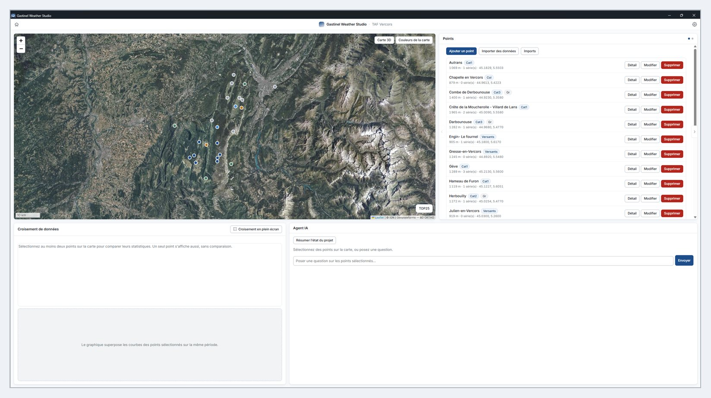
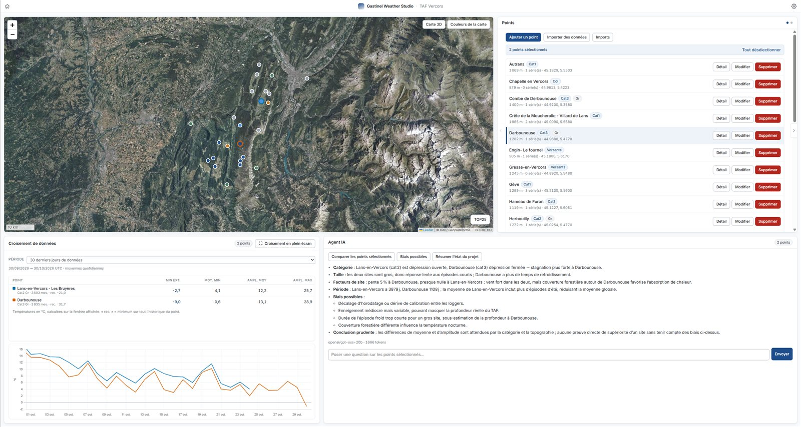
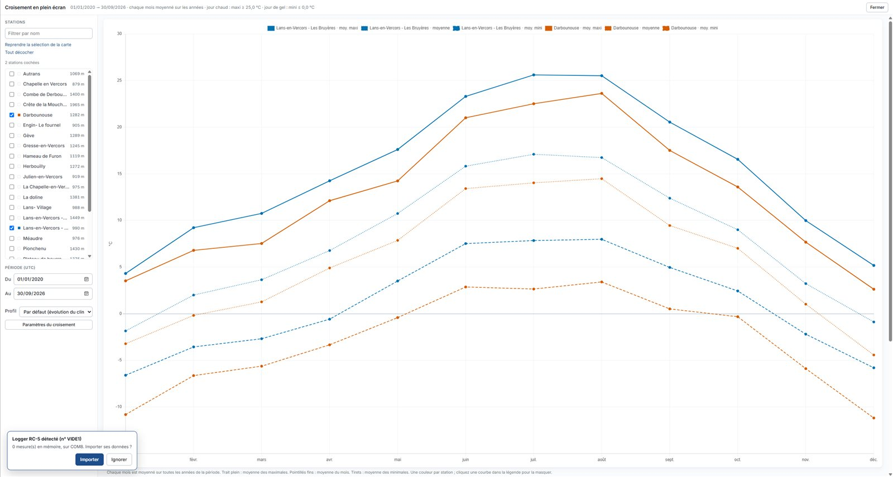
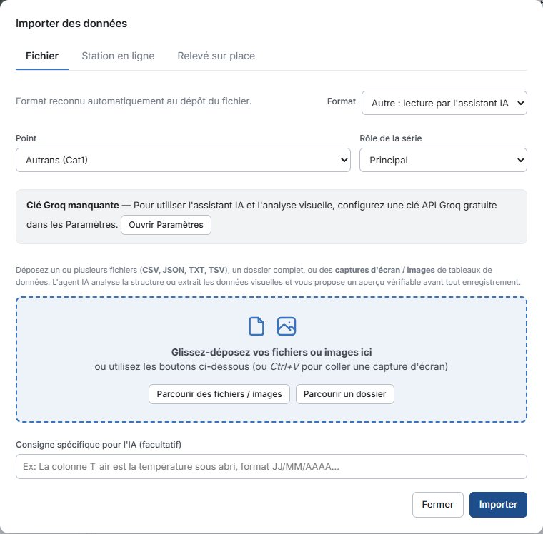
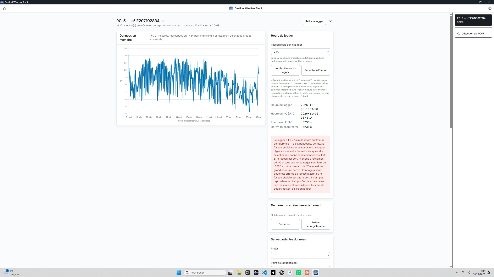
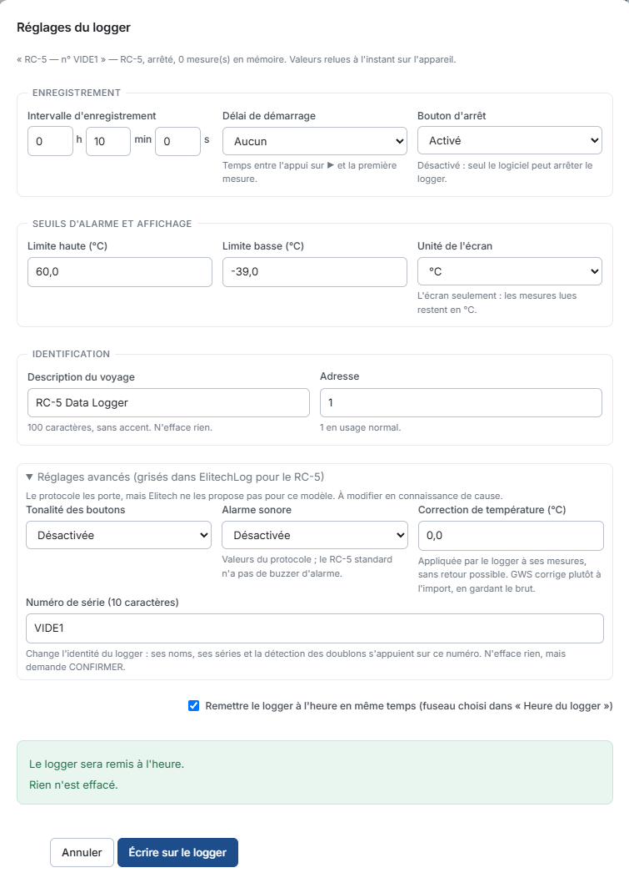
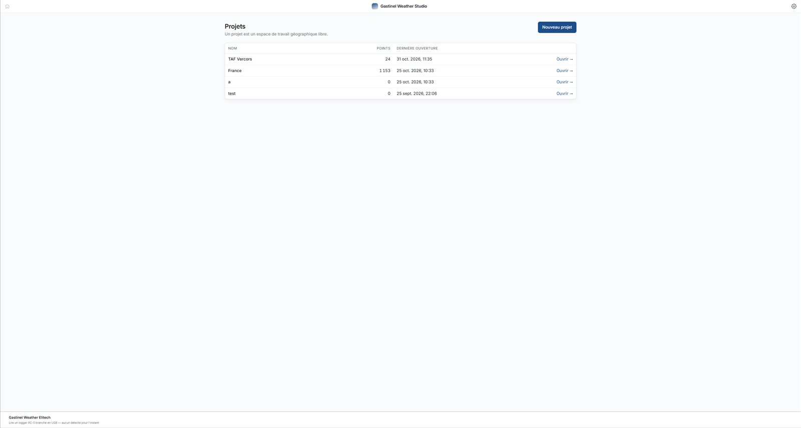
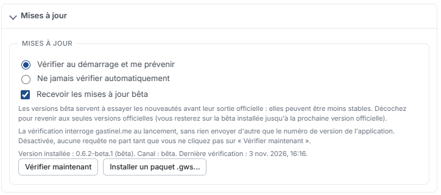
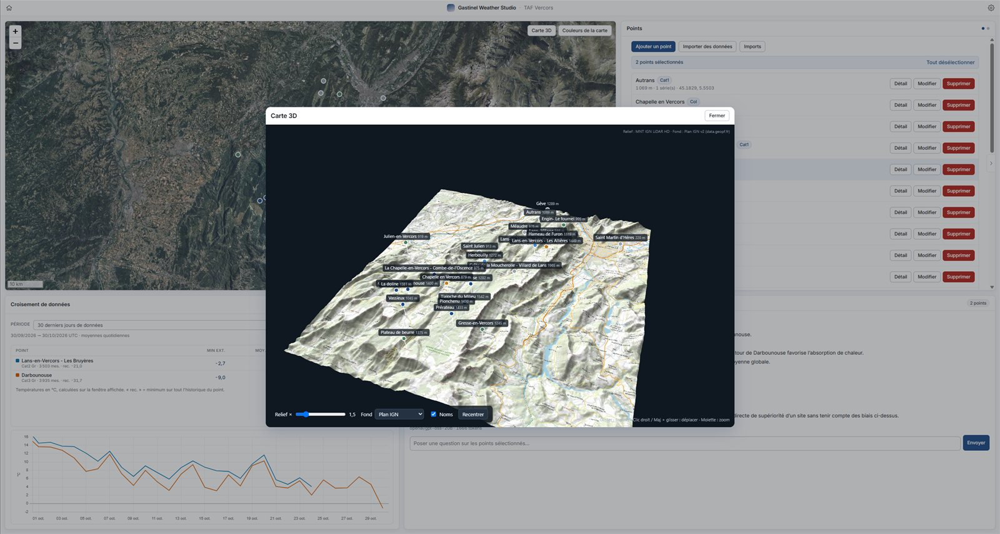

<p align="center">
  
</p>

<h1 align="center">Gastinel Weather Studio</h1>

<p align="center">
  Centraliser, cartographier et analyser des relevés de température — en particulier ceux des trous à froid du Vercors.<br>
  <strong>Windows · Android · Rust + Tauri v2 · GPL-3.0</strong>
</p>

<p align="center">
  <a href="https://gastinel.me/gws/download/"><strong>⬇ Télécharger pour Windows</strong></a>
  &nbsp;·&nbsp; <a href="#mises-à-jour--paquets-gws-canal-officiel-ou-bêta">Mises à jour</a>
  &nbsp;·&nbsp; <a href="#feuille-de-route">Feuille de route</a>
</p>

<p align="center">
  
</p>

Application de bureau (Windows, avec une cible Android) pour **centraliser, cartographier et analyser des relevés de température** — en particulier ceux des trous à froid (TAF) du Vercors. Écrite en Rust avec Tauri v2, interface en HTML/CSS/JS sans bundler.

> État : projet personnel en développement (version 0.6.x). Le logiciel fonctionne et a été testé sur le terrain.
>
> **Android** : une version stable est en préparation et arrive bientôt (la lecture USB du logger y fonctionne déjà).

## Aperçu

### Croiser les séries

Sélectionnez deux points ou plus sur la carte : statistiques côte à côte, courbes superposées et, si vous le souhaitez, une lecture par l'agent d'analyse.

| Dans le studio | En plein écran (moyennes mensuelles sur plusieurs années) |
|---|---|
|  |  |

### Importer des données

Un seul panneau pour trois sources : un **fichier** (format reconnu au contenu), une **station en ligne** (API Infoclimat), ou un **relevé sur place** (saisie à la main ou logger RC-5 branché).

<p align="center"></p>

### Gastinel Weather Elitech : lire un logger RC-5 sans ElitechLog

Branchez un enregistreur **Elitech RC-5** en USB : l'application le détecte toute seule et propose d'importer sa mémoire. La page Elitech lit les mesures directement par le port série, vérifie et remet à l'heure l'horloge du logger, démarre ou arrête l'enregistrement, puis rattache la série à un point d'un projet. Les mesures obtenues sont identiques à celles d'un export ElitechLog (vérifié par un test permanent). Fonctionne aussi sur Android.

<p align="center"></p>
<p align="center"><em>RC-5 connecté : graphique des mesures en mémoire et vérification de l'horloge du logger.</em></p>

Les **réglages du logger** vont plus loin qu'ElitechLog : intervalle, délai de démarrage, bouton d'arrêt, seuils d'alarme, unité de l'écran, et des réglages avancés que le protocole porte mais qu'ElitechLog grise pour le RC-5 (tonalité, correction de température, numéro de série). Tout est relu sur l'appareil avant d'écrire, et rien n'est effacé.

<p align="center"></p>

## Le logiciel

- **Carte** interactive sur fonds IGN (orthophoto, TOP25), avec les points de mesure et les stations.
- **Projets** : chaque projet est un espace de travail géographique libre.

<p align="center"></p>

- **Import de relevés** : exports ElitechLog (`.xls`), Infoclimat (JSON et CSV), archives ROMMA (`.csv`), et tout autre tableau ou capture d'écran lu par l'assistant (aperçu vérifiable avant enregistrement).
- **Lecture directe du logger Elitech RC-5** par le port série USB (voir plus haut).
- **API Infoclimat** : récupération des données de stations avec votre propre clé.
- **Croisement** : statistiques côte à côte et courbes superposées, vue plein écran.
- **Agent d'analyse** (optionnel) via l'API Groq, avec votre propre clé.
- **Export** en CSV, TXT et HTML.
- Données stockées **localement** (SQLite). Rien n'est envoyé ailleurs sans action de votre part.

## Mises à jour : paquets `.gws`, canal officiel ou bêta

Les mises à jour arrivent sous forme de **paquet `.gws`** : un double-clic (ou **Installer un paquet .gws…**) suffit, sans réinstaller. Chaque paquet est **signé (Ed25519)** : l'application refuse tout paquet dont la signature ou l'empreinte de l'exécutable ne correspond pas. Détails dans [`docs/signature-maj.md`](docs/signature-maj.md).

Au démarrage, l'application peut **vous prévenir qu'une nouvelle version existe**, sur le **canal officiel** ou, si vous cochez la case, sur le **canal bêta** pour essayer les nouveautés en avance. La vérification n'envoie que le numéro de version ; vous pouvez aussi la désactiver et ne vérifier qu'à la main.

<p align="center"></p>

## Les extensions

À côté du logiciel, des **extensions natives** (`.dll`) ajoutent des fonctions sans recompiler l'application. Elles s'activent dans **Paramètres → Extensions** ; détails et API dans [`extensions/README.md`](extensions/README.md).

| Extension | Ce qu'elle ajoute |
|---|---|
| **Carte 3D** | Relief 3D du terrain (MNT IGN LiDAR HD) avec les points du projet. |
| **Couleurs de la carte** | Luminosité, saturation et rendu des fonds IGN. |

<p align="center"></p>

## Créer une extension

Une extension est un dossier avec un `manifest.json`, une `.dll` Rust et, si besoin, une interface HTML. La crate [`extensions/gws-extension-api`](extensions/gws-extension-api) fournit l'API ; les extensions Carte 3D et Couleurs de la carte servent d'exemples. Format du manifeste, permissions (`db_read`, `db_write`) et risques acceptés : [`extensions/README.md`](extensions/README.md).

## Compiler

Prérequis : [Rust](https://rustup.rs) (stable, 1.77.2 ou plus), les Build Tools MSVC avec le SDK Windows, WebView2 (présent sur Windows 11) et la CLI Tauri (`cargo install tauri-cli --version "^2"`). Node.js n'est pas nécessaire.

```bash
cargo tauri dev      # lancer en développement
cargo tauri build    # produire l'exécutable
cargo test --manifest-path src-tauri/Cargo.toml
```

La première compilation est longue (Tauri et SQLite sont compilés depuis les sources). Deux tests font de vrais appels réseau et sont ignorés par défaut ; un autre demande un RC-5 branché en USB.

## Clés d'API

Aucune clé n'est fournie. Pour utiliser l'API Infoclimat ou l'assistant Groq, créez vos propres clés et déposez-les dans un dossier `Clee.API/` (par exemple `Clee.API/API.Groq.env`), ou saisissez-les dans l'application. Ce dossier est ignoré par git et les clés restent sur votre machine.

## Feuille de route

Objectifs par génération ; les détails peuvent bouger. Version complète : [`docs/roadmap.md`](docs/roadmap.md).

| Version | Cap |
|---|---|
| **0.7.0** | Import Elitech par période, optimisation de la mémoire ; application Android (fonctions choisies pour le téléphone, relevé de terrain validé avant d'entrer dans le projet). |
| **avant 0.8.0** | Écran de mise à jour repensé, avec une animation par génération. |
| **0.8.0** | Écosystème : téléphone et ordinateurs reliés, projets Cloud publiables en lecture seule. |
| **0.9.0** | iPhone et Mac, Linux (dont ARM64), téléphones pliables. |
| **1.0** | Tout importer : RC-5 Pro, Voltcraft DL-101T et DL-121TH, et les autres formats rencontrés. |
| **1.1** | Logiciel compagnon très léger (moins de 10 Mo) pour lire et régler les loggers sur le terrain. |
| **1.5 et 2.0** | Extensions et compatibilité avec des outils développés par d'autres. |

## Licence

Logiciel libre sous **GNU GPL v3 ou ultérieure** (`GPL-3.0-or-later`), texte dans [`LICENSE`](LICENSE).

Le nom « Gastinel Weather Studio » et le logo ne sont pas couverts par cette licence (GPL v3, art. 7 e) : une version modifiée doit porter un autre nom. Détails dans [`TRADEMARKS.md`](TRADEMARKS.md).
